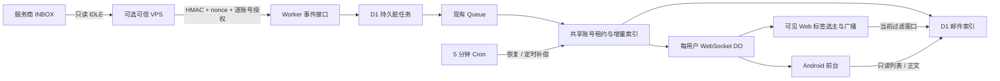

# 实时同步验收与测量

本次使用 ArronHC/OmniMail main 的现有检出（初始 `024e150`），没有将用户提及的 upstream 地址强制替换为另一个仓库。实现保留 Cloudflare Email Routing / D1 / R2 /原队列，自建邮箱接收路径未重写。



改造前：第三方收件依赖每 5 分钟 Cron + `next_sync_at` + Queue；Web 主要初始/手动读取，Android 没有第三方聚合阅读和前台索引订阅。改造后：有明确授权的账号使用 IDLE 事件触发同一增量索引，健康 IDLE 补偿默认 30 分钟，离线/关闭恢复原补偿；前台在索引信号后读取当前窗口。无 VPS / 未启用的实例继续原行为。Queue 投递未知、服务商事件延迟、首次导入、大历史缺口和后台应用均不保证 10 秒。

## 自动验收

截至本次验收执行，以下为已运行的本地验证，不等于生产服务商验证。

| 检查 | 结果 / 范围 |
|---|---|
| 根单元测试 | 172 文件、826 测试通过（原 823 + 延迟统计 3） |
| Worker 集成 | 11 文件、77 测试；含 25 项实时专项，真实 D1、真实 RSA/AES、真实 DO WebSocket；IMAP/OAuth 外部返回为 mock |
| VPS 监听测试 | 6 项，含真实 TLS 本地 IMAP Server + ImapFlow IDLE、实际延迟重连、认证错误冷却、撤销/凭据版本、无 IDLE 回退 |
| Web 浏览器 | 97 项，系统 Chromium；新事件显示、两页共用 socket/广播和五轮可见性测量 |
| Android | 40 单元测试，`:app:testDebugUnitTest :app:assembleDebug` 通过；未跑 Android 实机/模拟器 UI 或 FCM |
| 构建 | 类型检查、文件行数、现有 lint、Web/Worker、extension、listener 均通过 |
| 本地数据库 | 迁移 0041 成功，重复迁移无 pending；未写生产 D1 |
| Worker 打包 | `deploy --dry-run` 成功，仅打包 |
| Docker | 实际镜像构建成功、uid 1000 /只读/无 capabilities 运行；无外网的真实 main 进程用签名检查 mock manifest 启动，`/health` 返回 200；已清理测试容器 |
| 本地运行 | Worker `/api/health` 200，Vite 代理 `/api/config` 全部 setupRequirements 为 true，实时增强默认关闭 |

原有浏览器动画测试曾在并行运行时未观察到瞬时 `is-typing` 类，单独重跑通过；原有 deployment-target 测试曾在构建/浏览器并行负载下超过 5 秒，单独及最终低并发全套通过。没有删测试、放宽业务断言或改动邮件阅读动画来掩盖问题。Extension 构建通过，但系统 Chromium 无法加载 extension smoke 的 service worker，该可选原有运行测试仍未验证；浏览器官方版本下载需环境网络设置生效。

| 必需场景 | 自动证据 |
|---|---|
| 新邮件事件启动增量索引 | realtime.integration.ts 在 next_sync_at 远期仍索引新 UID；imap.node.ts TLS IDLE 事件；Gmail 浏览器事件显示 |
| 重复事件不重复邮件 | 同 nonce 防重放、不同 nonce/重复 UID 后 D1 单行 |
| 多事件并发安全 | 脏序号、Queue reservation、任务/账号 lease 并发测试；过期 lease 被接管后旧响应不能写索引 |
| VPS 网络中断恢复 | listener.node.ts 等待真实 4–6 秒重连定时器，其他邮箱连接仍存活 |
| 停机期间不永久遗漏 | 离线恢复原 next_sync_at、Cron 重投持久脏任务、重连 catch-up、共享过期 lease 恢复；大缺口须多轮扫描 |
| Microsoft token 到期 | Worker mock OAuth 刷新/rotation，封装仅 access token；invalid_grant 拒绝 |
| 错误凭据不无限重试 | 模拟 IMAP authenticationFailed，确认 12–18 分钟 timer 且短期不重新连接 |
| 删除/撤销后不能访问 | 用户停用/删除、邮箱删除、授权撤销使 validSubscription 无效，listener 清单撤销关闭；换设备公钥要求重新授权 |
| 未授权跨用户同步 | owner/普通用户权限、伪造 account/subscription、来源 Origin、时间窗、HMAC 篡改、nonce/key 过期 |
| 原有自建收发 | 既有 receive-email、send、API、重试、Quota、Queue 的原测试集回归通过；未执行真实 SMTP/Email Routing 外网收发 |
| 原有 Gmail/Outlook/QQ 手动同步 | 原 sync-control、message API 与三家 Workspace 浏览器用例；MS 文件夹直接 refresh 共享账号 lease |
| 实时关闭仍可补偿 | 全局设置关闭和 env 开关关闭恢复 due 调度，原 Cron/手动入口独立于实时预算 |

写索引前会原子续期并校验账号 lease；已失去 lease 的旧 IMAP 响应不能覆盖新任务。账号 lease 360 秒、事件任务 lease 420 秒；Queue 在长时间失败时由持久记录和 Cron 恢复。该机制仍不提供分布式系统意义上的无限时长执行保障，单次同步须保持有界；极端数据库停顿或长任务由租约/唯一 UID 和后续补偿恢复。

## 实际测到的 Web 段延迟

[原始五轮 JSON](mock-web-latency.json) 为浏览器实际执行结果，标签 `source=mock, segment=web`。测的是“mock 索引信号发送 → 页面确实出现唯一 subject”，P50 **279 ms**，P95/P99 **307 ms**（5 个样本，nearest-rank，尾分位只代表该小样本最大值）。五轮分别 265、307、287、243、279 ms。

这些数字只证明本地前端事件更新，不含服务商收信、VPS、真实 HTTPS 或 Cloudflare Queue 投递；**不能作为端到端 10 秒收信达标结果**。TLS IMAP、Worker D1/DO 和 Web 分别以自动测试验证，未用单一真实邮箱贯穿所有生产环节。

## 多轮真实邮件测量工具

需要部署者提供/执行：有效生产账号、可信 VPS、Cloudflare 部署与 migrations/Secret、公网 HTTPS origin，以及启用前台的 Web/Android。仓库不含真实凭据。本次真实样本 **0**，真实 P50/P95/P99 **未测**。

1. VPS/Cloudflare/浏览器均同步 NTP。每家服务商至少 20–100 轮，分正常、断线恢复、token 更新、并发/高流量。每轮唯一 subject，例如 `omnimail-probe-<uuid>`；同一账号逐轮等待前一封可见再发下一封，避免批次歧义。
2. 在服务商确认投递时记录 UTC 毫秒 `arrivedAt`，使用服务商服务端 Received/权威投递记录。发送时间、RFC `Date` 头、打开服务商页面的人工时间均不等同于到达时间。若拿不到准确到达时间，注明缺失，禁止用其它时间伪造。
3. 在仓库外私有目录准备 ARRIVALS_JSONL，每行含 `id,provider,accountId,subject`，确认投递后追加/更新 `arrivedAt`。提前写目标，以便监听已经启动。provider 为 gmail/microsoft/qq/naver/yandex（Worker 命名）。
4. 用 Playwright codegen 或现有浏览器工作流保存已登录 Web storage state 到仓库外文件，`umask 077`，权限 0600；里面含会话 Cookie，不提交、不分享。生产测量页面直接打开 `/gmail` 等对应 Workspace，不选会排除目标邮件的搜索/筛选，并保持可见。
5. 执行：

```bash
CHROMIUM_PATH=/usr/bin/chromium PROBE_HEADED=true node scripts/realtime-probe.mjs \
  https://mail.example.com/gmail /secure/browser-state.json \
  /secure/arrivals.jsonl /secure/measurements.jsonl
node scripts/realtime-latency.mjs /secure/measurements.jsonl
```

probe 观察页面已有 socket 的真实帧，保存 detectedAt（VPS）、receivedAt（Worker）、indexedAt（D1 完成）、clientDiscoveredAt（浏览器收到帧）、visibleAt（唯一 subject 可见），不额外创建 Worker 轮询。每 100 ms 只检查 DOM，可见时间有相应采样误差。等待默认 10 分钟、`PROBE_TIMEOUT_MS` 可配置；超时未完成样本不计成功。输出文件权限 0600，不含邮件正文、Token 或密码。

Worker 时间属于**账号事件批次**，`correlation=account_batch`，尚未把每个 EXISTS 精确绑定到单封邮件 UID。真实测量须逐轮、安静账号，并核对 measurementId 与 D1 新索引；合并批次/其它来信造成歧义时不能将其写成精确单邮件链路。若时间非单调，统计器拒绝，先核对时钟或批次归属。

latency 工具按 source 分别输出 real/mock 的六段 P50/P95/P99、样本数和 10 秒内数量，拒绝重复 id、缺失到达时间和不合理时序。空真实数据输出 null，不制造分位结果。Android 可前台手工/仪表测试补 visibleAt，后台秒级通知需要独立 FCM 工程，本工具目前自动测 Web。

## 交付与剩余生产验收

阶段 A 审计、B 原型、C 服务商/恢复、D Web/Android/管理、E 缺陷修复与测量工具分别提交。源码新增集中在 `realtime-listener/`、`email-worker/src/features/realtime/`、`migrations/0041_realtime_sync.sql`、`src/features/realtime/` 和 Android 新阅读/前台模块；原服务商同步入口仅增加复用/互斥/补偿通知，MS 增量元数据与 Gmail UID reset 修复直接服务此任务。

上线前尚需：五家真实账号认证/IDLE/连接限额测试、多轮真实完整链路分位数据、真实 Queue 排队和负载/账单测量、VPS 重启及真实网络故障演练、ARM64 镜像、Android 实机前后台兼容性。缺少这些不阻止已实现代码和本地验收交付，但不应将本次结果写为生产“10 秒 SLA 已达成”。


已保存云环境安装/启动配置草稿；当前工作区的 JDK/Android SDK 和依赖缓存可用，发布后须重启服务。A–D 提交分别为 `eaaf4ba`、`dc66126`、`20bd801`、`4fe83a1`，E 为本报告所在的验收提交。所有五阶段提交均在本地，未 push；本地提交跨新任务的自动恢复尚未验证。额外保存的 Git bundle 位于 `/workspace/omnimail-onboarding/omnimail-realtime.bundle`，可先下载保留并用于手动恢复。
